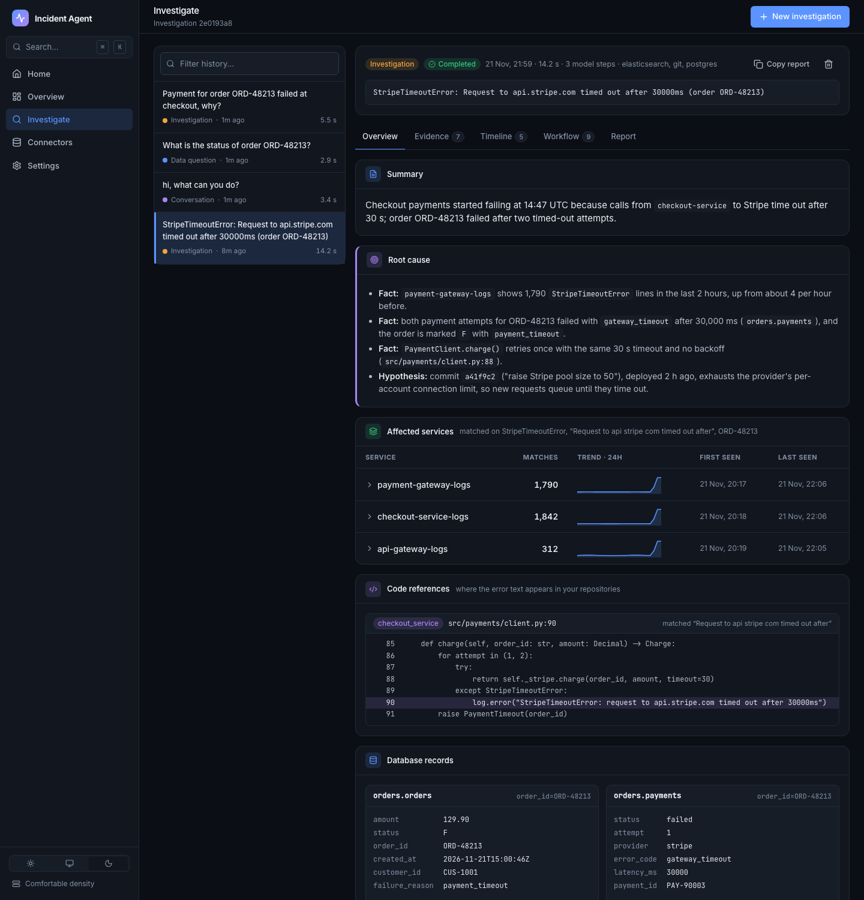
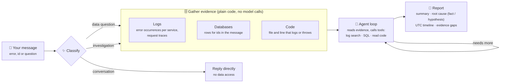
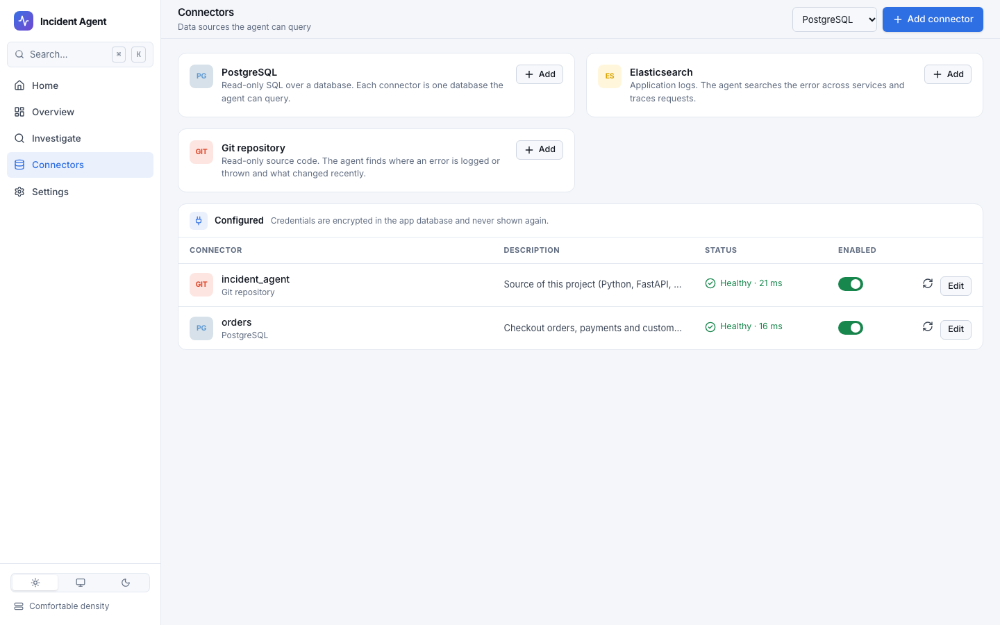
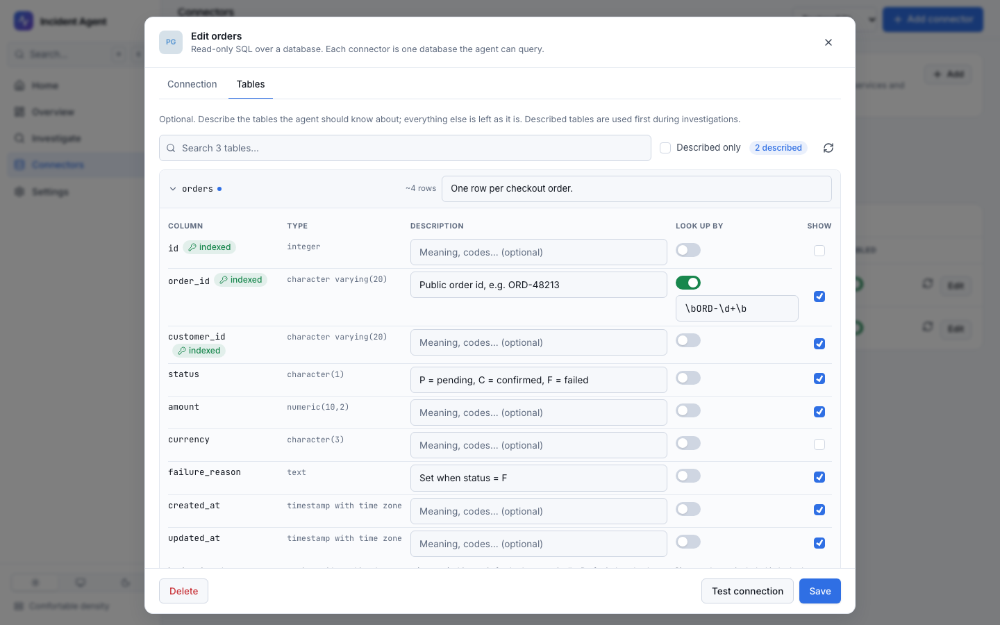
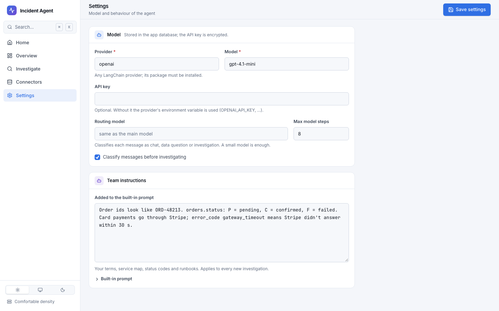
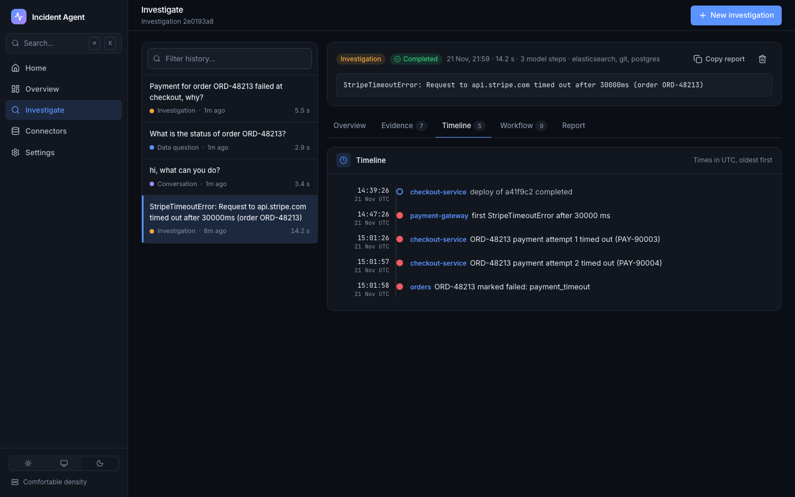
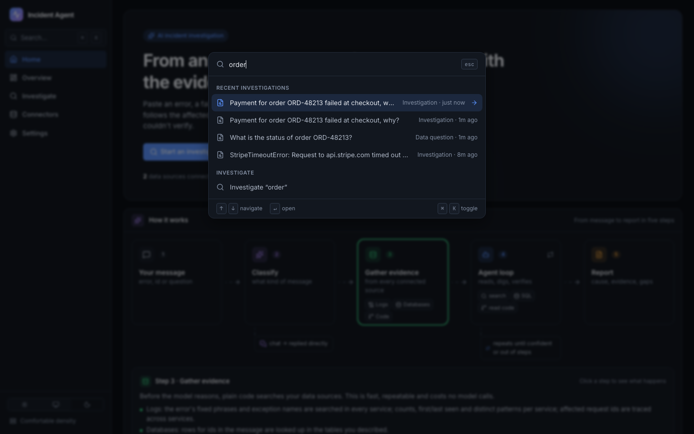

<div align="center">

# Incident Agent

**From an error message to its root cause, with the evidence.**

An open-source AI agent that investigates production incidents. Paste an error,
a failing id or a question; it searches your logs, databases and code, follows
the affected request across services and explains what happened, and what it
couldn't verify.

[**Website**](https://subhamyadav580.github.io/incident-agent/) ·
[Quickstart](#quickstart) ·
[Using the app](#using-the-app) ·
[Connectors](#connectors) ·
[Writing a plugin](#writing-a-plugin)



<sub>Screenshots use example data from a demo shop.</sub>

</div>

## Features

| | |
|---|---|
| **Live investigation** | Steps stream in as they happen: classifying, searching logs, looking up records, reading code, each ticked off with what it found. |
| **Evidence-first reports** | Summary, root cause with every point marked *Fact* or *Hypothesis*, a timeline across services in UTC, and evidence gaps with the next check worth doing. |
| **Affected services** | Per service: true match count, hourly trend, first/last seen and the distinct log patterns, so 100k lines become a few readable rows. |
| **Code references** | The exact file and line that logs or throws the error, from your Git repositories. |
| **Database records** | Rows for the ids in your message, from the tables you describe. |
| **Workflow trace** | Every step of a run, with model calls and tokens, tool calls and results, timings and failures. |
| **Configured in the UI** | Connectors, credentials (encrypted), table and log descriptions, model and team instructions. No config files. |
| **Keyboard-first** | <kbd>⌘</kbd> <kbd>K</kbd> command palette for every page and action; paste an error straight into it. |
| **Read-only and local** | SQL limited to `SELECT`, statement timeouts and row caps; read-only Git; runs on 127.0.0.1 with any LangChain-supported model. |

## How it works



1. **Classify.** One small model call decides whether the message is a chat
   message (answered directly), a data question (database lookups, no log
   search) or an incident to investigate.
2. **Gather evidence (plain code, no model calls).** Logs: the error's exception
   names and fixed phrases are searched in every service you described (or all
   of them, if you described none), returning counts, first/last seen, an hourly
   histogram and distinct patterns per service; affected request ids are traced
   across services. Databases: rows for ids in the message are looked up. Code:
   the file and line that logs or throws the error.
3. **Agent loop.** The model reads the evidence and calls tools only to fill
   gaps (a wider time range, a related id, database state, the code around a
   match), until it can explain the failure or the step budget runs out. Built on
   [LangGraph](https://github.com/langchain-ai/langgraph).
4. **Report.** Written with fixed sections so the UI can show each as a card.

## Quickstart

Requires Python 3.11+, [uv](https://docs.astral.sh/uv/), Node 20+ (to build
the web UI once) and a local PostgreSQL for the app's own data (connectors,
credentials, settings, history).

```bash
git clone https://github.com/subhamyadav580/incident-agent.git
cd incident-agent
uv sync
(cd frontend && npm install && npm run build)    # builds the UI into the server package

cp .env.example .env
uv run incident-agent-server --generate-key      # paste into .env as APP_SECRET_KEY
uv run incident-agent-server                      # → http://127.0.0.1:8000
```

The app database (`APP_DATABASE_URL`, default
`postgresql://localhost:5432/incident_agent`) is created on first start.

## Using the app

### 1. Connect a data source

**Connectors → Add connector** (or <kbd>⌘</kbd> <kbd>K</kbd> → "Add … connector").
Pick PostgreSQL, Elasticsearch or a Git repository, fill in the connection,
press **Test connection**, then **Save**. Passwords and tokens are encrypted and
never shown again. Each connector has an enable switch and a live health check.



### 2. Describe your data (optional)

Open a connector's second tab. **PostgreSQL → Tables** and **Elasticsearch →
Index groups** list what's actually in the source; expand a table to see its
columns, types and indexes, or an index group to see its fields.

- Add a description where it helps (what the table holds, what status codes mean).
- **Look up by**: when a message contains an id matching the pattern (e.g.
  `\bORD-\d+\b`), that row is fetched automatically. Prefer indexed columns.
- For log groups, tick the fields to **Return**, the fields to **Search** for
  ids and error text, and the **Timestamp** field.

Anything left blank stays as it is; without descriptions the agent still finds
its way.



### 3. Choose the model and add team instructions

**Settings**: provider and model (any
[LangChain provider](https://python.langchain.com/docs/how_to/chat_models_universal_init/);
OpenAI works out of the box), an optional API key (otherwise the provider's
environment variable is used), a cheaper routing model, the step budget, and
**team instructions**: your id formats, status codes, service map and runbooks.



### 4. Investigate

**Investigate** (or <kbd>⌘</kbd> <kbd>K</kbd>, then paste): enter an error message,
a failing id or a question. The steps stream in while the agent works.


### 5. Read the report

Each investigation has tabs:

| Tab | What's in it |
|---|---|
| **Overview** | Summary, root cause (fact / hypothesis), top affected services, code references, database records, evidence gaps |
| **Evidence** | All affected services (click one for its log patterns), code references, request traces, database records |
| **Timeline** | Events across services, converted to UTC and ordered |
| **Workflow** | How the run went (below) |
| **Report** | The full Markdown report, also copyable |



### 6. See how it worked

The **Workflow** tab shows the pipeline (message → classify → gather data →
agent → report) and every step as a timed bar. Click a step for details: why an
intent was chosen, what a source found, tokens used, tool arguments, a result
preview and errors.


### Everywhere: ⌘K, Home and Overview

<kbd>⌘</kbd> <kbd>K</kbd> / <kbd>Ctrl</kbd> <kbd>K</kbd> opens the command palette:
jump to a page, start an investigation, add a connector, switch theme or
density, or reopen a past investigation. **Home** explains the flow and shows a
getting-started checklist; **Overview** is the dashboard (runs, failures, time
to answer, connector health, recent investigations).

| Command palette | Overview |
|---|---|
|  |  |

### CLI

The CLI uses the same app database, so it sees the same connectors and settings:

```bash
uv run incident-agent "request 0a5c19d9a57b86b6 returned 500"
echo "checkout is failing for user 8812" | uv run incident-agent -
```

## Development

### Frontend

The UI is React 19 + TypeScript, styled with Tailwind CSS v4 (design tokens
as CSS variables in `frontend/src/index.css`, light and dark themes, compact
and comfortable density). Data fetching uses TanStack Query; routing uses
React Router with pages loaded on demand.

```bash
uv run incident-agent-server          # API on :8000
cd frontend && npm run dev            # UI on :5173 with hot reload, proxies /api to :8000
npm run typecheck                     # strict TypeScript
npm run build                         # production build into src/incident_agent/server/static
```

### Website (GitHub Pages)

The project site is a static page in [`docs/`](docs/) (`docs/index.html` and
the screenshots in `docs/assets/screenshots/`); no build step. To publish it:
GitHub repository → **Settings → Pages → Build and deployment → Source:
Deploy from a branch → `main` / `/docs` → Save**. It is served at
`https://<user>.github.io/incident-agent/` a minute later and updates on every
push to `main`.

## Where things are stored

There are no config files. Everything is entered in the UI and stored in the
app database (`APP_DATABASE_URL`, created on first start):

| What | Where in the UI | Stored as |
|---|---|---|
| Connections (hosts, users, database names) | Connectors | `connectors.settings` |
| Passwords, API keys | Connectors, Settings | encrypted with `APP_SECRET_KEY` |
| Table and index-group descriptions, id lookups | Connector → Tables / Index groups tab | `connectors.settings` |
| Search tuning (time window, fields, id patterns) | Elasticsearch connector, *Advanced* | `connectors.settings` |
| Model, routing, step limit, team instructions | Settings | `app_settings` |

`.env` only holds what's needed to reach that database: `APP_DATABASE_URL`,
`APP_SECRET_KEY`, and optionally a provider key such as `OPENAI_API_KEY`.
Back up `APP_SECRET_KEY`: without it stored credentials can't be decrypted.

### Model

Any provider supported by LangChain's
[`init_chat_model`](https://python.langchain.com/docs/how_to/chat_models_universal_init/)
(openai, anthropic, google_genai, ollama, bedrock, ...). Install its package
(`uv add langchain-anthropic`) and set the provider and model in Settings.

### Describing your data (optional)

Without descriptions the agent still works: it finds the log groups that
mention the error and explores tables with `list_tables` / `describe_table`.
Descriptions make it faster and more accurate. Open a connector and go to its
second tab; the list is loaded live from the source, so there is nothing to
type by hand except the notes you want to add:

- **PostgreSQL → Tables:** every readable table with its size (child tables
  and partitions are folded into their parent). Add a description inline;
  expand a table to see its columns, types and which are indexed, then
  optionally describe a column (e.g. status codes), mark it **Look up by**
  with an id pattern (the row is fetched automatically when a message
  contains a matching id), and tick **Show** to limit the columns returned.
- **Elasticsearch → Index groups:** indices grouped by name with the date
  stripped (`checkout-logs-2026.10.21` → `checkout-logs`). Add a description
  inline; expand a group to see its fields from the mapping and tick which to
  **Return**, which to **Search** for ids and error text, and the
  **Timestamp** field. Described groups are searched for every incident.

Only what you fill in is saved; everything else is left as it is.

**Id formats:** by default ids are mixed letter-and-digit tokens of 6+
characters and numbers of 8+ digits. Set your own regexes in the Elasticsearch
connector's *Advanced* tab, e.g. `\bORD-\d+\b`.

## Connectors

| Connector | Tools | Prefetch | Without descriptions |
|---|---|---|---|
| Elasticsearch | `list_es_indices`, `get_index_mapping`, `search_on_index` | error occurrences + request traces | finds the index groups that mention the message |
| PostgreSQL | `list_databases`, `list_tables`, `describe_table`, `fetch_one`, `fetch_all` | rows for ids matching table lookups | model explores with `list_tables` / `describe_table` |
| Git repository | `search_code`, `read_file`, `list_files`, `recent_commits` | where the error text and exception names appear in the code, with surrounding lines | — (works on any repo) |

Several PostgreSQL connectors can be enabled at once; the agent sees each as a
named database. One Elasticsearch connector can be enabled at a time. Every SQL
query runs with a statement timeout.

**Git repositories** are read-only. A *remote* repo (HTTPS URL, optional
read-only access token) is cloned into `APP_DATA_DIR/repos` with the last
`history_days` of commits and fetched again every `refresh_minutes`; the token
is sent per command and never written into the clone. A *local* repo is read
in place from a path on the server machine. Log messages usually appear
literally in source code, so for an error message the agent gets the exact
file and line that logs or throws it, and can check `recent_commits` for a
change that shipped just before the incident. Add one connector per repo;
several can be enabled at once.

### Adding a connector type

The UI draws its forms from the server, so a new type needs no UI work:

1. A plugin (`src/incident_agent/plugins/<name>/`) with
   `create_plugin(options) -> Plugin`, see below.
2. A connector type (`src/incident_agent/server/services/connectors/<name>.py`)
   declaring its form fields, a connection test, and how its settings become
   plugin options; register it in `registry.py`.

## Writing a plugin

A plugin is any module with a `create_plugin(options) -> Plugin` function.
`options` is the dict built from its connector's settings.

```python
# my_package/loki_plugin.py
from langchain_core.tools import tool
from incident_agent import Plugin


def create_plugin(options: dict) -> Plugin:
    client = LokiClient(options["url"])

    @tool
    def query_loki(logql: str, since: str = "1h") -> list[dict]:
        """Run a LogQL query against Loki and return matching log lines."""
        return client.query(logql, since=since)

    def prefetch(message: str) -> str:
        """Optional: evidence gathered before the model runs."""
        return "Pre-fetched Loki evidence:\n" + client.search_ids_in(message)

    return Plugin(
        name="loki",
        tools=[query_loki],
        instructions="Logs in Loki. Query with LogQL; labels: app, env, level.",
        prefetch=prefetch,
        prefetch_intents=("investigation",),   # also: "data_question"
        close=client.close,
    )
```

Pass it to `build_agent` as `{"loki": {"enabled": True, "module": "my_package.loki_plugin", "url": ...}}`,
or add a connector type for it (above) to configure it from the UI.

Tool docstrings are the model's instructions for the tool, so describe the
arguments and when to use it. Tool names must be unique across plugins.

## API

`GET /api/connector-types`, `GET|POST /api/connectors`,
`PATCH|DELETE /api/connectors/{id}`, `POST /api/connectors/test`,
`GET /api/connectors/{id}/health`, `GET|PUT /api/settings`,
`POST|GET /api/investigations`, `POST /api/investigations/stream` (NDJSON step events), `GET|DELETE /api/investigations/{id}`, `GET /api/overview`. OpenAPI docs at `/docs`.

The server has no login and binds to 127.0.0.1 by default. Put it behind your
own auth before exposing it to a network.

## Using it as a library

```python
from incident_agent import AgentConfig, build_agent

plugins = {
    "postgres": {"enabled": True, "databases": [
        {"name": "orders", "url": "postgresql://readonly:...@db/orders", "description": "Orders"},
    ]},
    "elasticsearch": {"enabled": True, "connection": {"hosts": "http://es:9200"}},
}
with build_agent(AgentConfig(model_name="gpt-4.1-mini"), plugins) as agent:
    print(agent.investigate("order 48213 failed at checkout"))
```

## Safety

- The SQL tools accept only a single `SELECT`/`WITH` statement and reject
  write keywords. That is a guardrail, not a security boundary: **connect with
  a read-only database role.** The same goes for Elasticsearch credentials.
- Retrieved logs and rows are sent to your model provider. Check that this is
  acceptable for your data before pointing the agent at production.
- The system prompt tells the model to treat retrieved data as untrusted input
  and to separate facts from hypotheses.

## Project layout

```
frontend/             # React + TypeScript + Tailwind UI
  src/api/            #   typed API client and TanStack Query hooks
  src/components/     #   app shell, UI primitives, status badges
  src/features/       #   overview, investigations, connectors, settings pages
  src/lib/            #   formatting, report/timeline parsing, theme & density
src/incident_agent/
  cli.py              # `incident-agent` command (reads the app database)
  app.py              # AgentConfig + build_agent(): settings + plugin options -> harness
  prompts/system.md   # built-in system prompt
  harness/            # LangGraph loop, limits, tracing
  server/             # web UI + API (FastAPI), layered:
    routes/           #   path -> handler registration
    api/handlers/     #   HTTP concerns, error -> status mapping
    services/         #   connectors (CRUD, test, type registry), investigation
    repos/ models/ db/ #  persistence (local PostgreSQL)
    schemas/ core/    #   Pydantic contracts, settings, credential encryption
    static/           #   built UI (generated by `npm run build`, not committed)
  plugins/
    base.py           # the Plugin contract
    elasticsearch/    # client, index grouping, tools, prefetch
    postgres/         # database registry, read-only SQL tools
```
