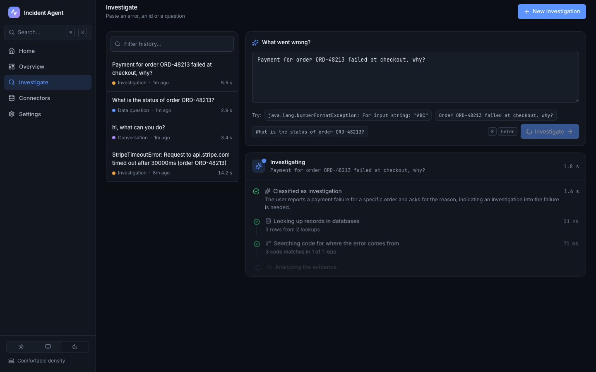
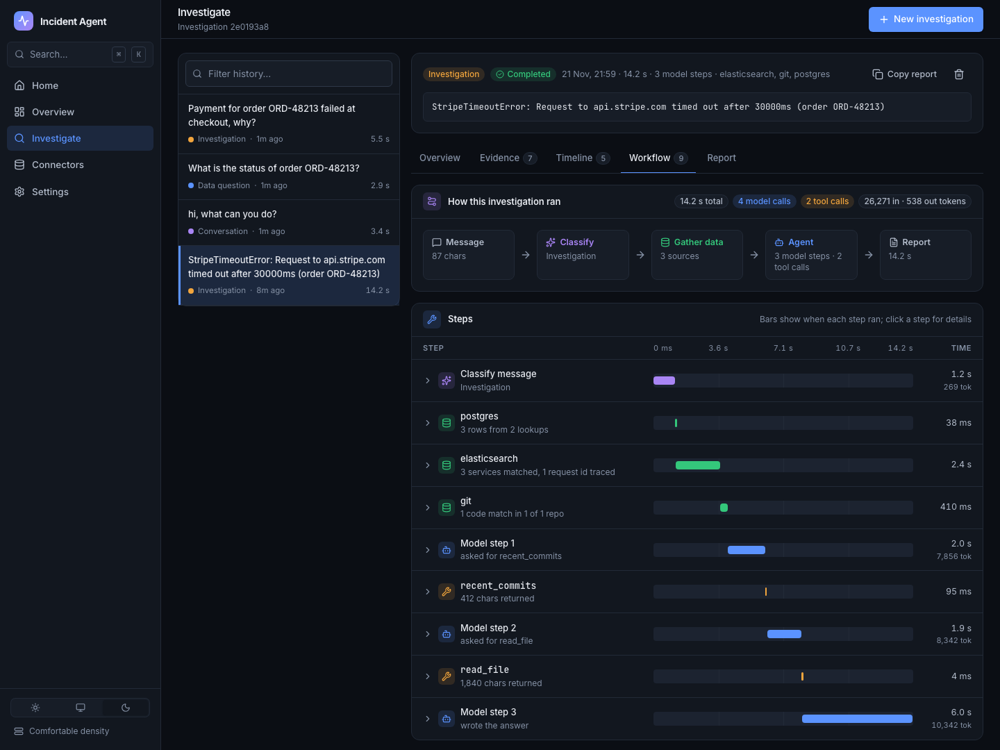
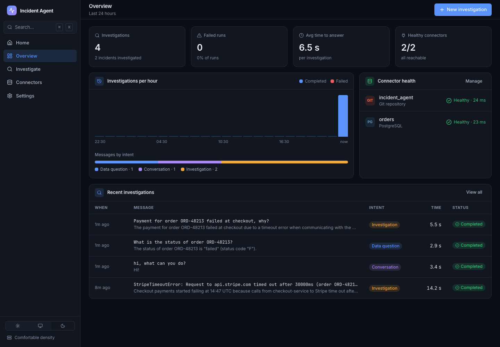
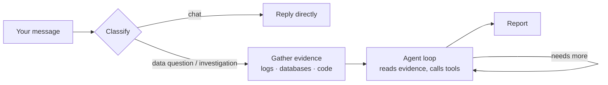

<div align="center">

# Incident Agent

**From an error message to its root cause, with the evidence.**

Paste an error, a failing id or a question. The agent searches your logs,
databases and code, follows the affected request across services and writes a
report: what happened, the likely cause, a timeline, and what it couldn't verify.

**[🌐 Website](https://subhamyadav580.github.io/incident-agent/)** ·
[Setup](#setup) ·
[Using the app](#using-the-app) ·
[How it works](#how-it-works) ·
[Reference](#reference)


<sub>Screenshots use example data.</sub>

</div>

## Highlights

- **Evidence-first reports.** Every root-cause point is marked *Fact* or *Hypothesis* and backed by logs, database rows or code.
- **Live progress.** Watch each step happen: searching logs, looking up records, reading code, writing the report.
- **Works with what you have.** Elasticsearch, PostgreSQL and Git repositories, added and described in the UI.
- **Transparent.** A workflow view shows every model call, tool call, timing and token count.
- **Safe by default.** Read-only SQL with timeouts, read-only Git, encrypted credentials, runs on your machine.

## Setup

### Requirements

- Python 3.11+ and [uv](https://docs.astral.sh/uv/)
- Node.js 20+ (to build the web UI)
- PostgreSQL, for the app's own data (connectors, settings, history)
- An API key for a model provider (OpenAI by default)

### Steps

**1. Get the code and install dependencies**

```bash
git clone https://github.com/subhamyadav580/incident-agent.git
cd incident-agent
uv sync
```

**2. Build the web UI**

```bash
cd frontend && npm install && npm run build && cd ..
```

**3. Configure**

```bash
cp .env.example .env
uv run incident-agent-server --generate-key
```

Open `.env` and set:

| Variable | Value |
|---|---|
| `APP_DATABASE_URL` | Your PostgreSQL, e.g. `postgresql://localhost:5432/incident_agent`. The database is created on first start. |
| `APP_SECRET_KEY` | The key printed above. It encrypts stored passwords; keep a copy somewhere safe. |
| `OPENAI_API_KEY` | Optional here; you can also enter the key in **Settings**. |

**4. Start**

```bash
uv run incident-agent-server
```

Open **http://127.0.0.1:8000**.

## Using the app

**1. Add a data source.** Go to **Connectors → Add connector**, choose
PostgreSQL, Elasticsearch or Git, fill in the connection and press
**Test connection**, then **Save**. Use read-only credentials.

**2. Describe your data (optional).** Open the connector's **Tables** or
**Index groups** tab. The list loads from the source; add notes where they help,
such as what a table holds or what status codes mean. For tables, turn on
**Look up by** for an id column (e.g. pattern `\bORD-\d+\b`) so matching rows
are fetched automatically.

**3. Choose the model.** In **Settings**, pick the provider and model, add an
API key if you didn't set one in `.env`, and write **team instructions**: your
id formats, status codes and service names.

**4. Investigate.** Go to **Investigate** and paste an error message, a failing
id or a question. You can also press <kbd>⌘</kbd> <kbd>K</kbd> (or
<kbd>Ctrl</kbd> <kbd>K</kbd>) anywhere and paste it there.

**5. Read the report.** Each investigation has tabs: **Overview** (summary,
root cause, key evidence), **Evidence** (affected services, code, request
traces, records), **Timeline** (in UTC), **Workflow** (how the run went) and
**Report** (full text).

<details>
<summary><b>Screenshots</b></summary>

| Live progress | Workflow |
|---|---|
|  |  |

| Connectors | Describing tables |
|---|---|
|  |  |

| Overview | Command palette |
|---|---|
|  |  |

</details>

### Command line

The CLI uses the same database, so it sees the same connectors and settings:

```bash
uv run incident-agent "Order ORD-48213 failed at checkout, why?"
echo "checkout is failing for user 8812" | uv run incident-agent -    # from stdin
uv run incident-agent -q "..."                                          # report only
```

## How it works



1. **Classify.** A small model call decides whether the message is a chat
   message, a question about data, or an incident to investigate.
2. **Gather evidence.** Plain code, no model calls. It searches the error's
   exception names and fixed phrases in your logs (count, trend and patterns per
   service), traces the affected request ids across services, looks up database
   rows for ids in the message, and finds the code line that logs the error.
3. **Agent loop.** The model reads the evidence and uses tools only to fill gaps
   (log search, read-only SQL, code search and file reading), until it can
   explain the failure or reaches the step limit.
4. **Report.** Summary, root cause, timeline and evidence gaps.

## Reference

### Connectors

| Connector | What the agent can do | Without descriptions |
|---|---|---|
| **Elasticsearch** | Search the error across services, trace requests, read index mappings | Finds the index groups that mention the error |
| **PostgreSQL** | Read-only SQL; automatic row lookups for ids in the message | Explores tables and columns itself |
| **Git repository** | Search code, read files, list recent commits | Works on any repository |

- You can enable several PostgreSQL databases and Git repositories at once, but only one Elasticsearch cluster.
- Remote Git repositories are cloned read-only into `APP_DATA_DIR/repos` and refreshed every 15 minutes. Local repositories are read in place.
- Elasticsearch search settings (time window, fields, id patterns) are in the connector's **Advanced** tab.

### Configuration

Connectors, credentials and settings are entered in the UI and stored in the
app database. `.env` only holds what's needed to start:

| Variable | Default | Purpose |
|---|---|---|
| `APP_DATABASE_URL` | `postgresql://localhost:5432/incident_agent` | App database (created if missing) |
| `APP_SECRET_KEY` | (required) | Encrypts stored credentials |
| `OPENAI_API_KEY`, `ANTHROPIC_API_KEY`, … | (none) | Provider key, if not set in Settings |
| `APP_DATA_DIR` | `~/.incident-agent` | Clones of remote Git repositories |
| `APP_HOST` / `APP_PORT` | `127.0.0.1` / `8000` | Server address |

**Models:** any provider supported by LangChain's
[`init_chat_model`](https://python.langchain.com/docs/how_to/chat_models_universal_init/).
For a provider other than OpenAI, install its package (e.g. `uv add langchain-anthropic`)
and select it in **Settings**.

### Security

- SQL is limited to single `SELECT` / `WITH` statements, with row caps and
  statement timeouts. This is a safeguard, not a permission system, so still use
  read-only database users.
- Git access is read-only, and tokens are never written into clones.
- Credentials are encrypted with `APP_SECRET_KEY` and never returned by the API.
- The server has no login and listens on `127.0.0.1`. Add your own
  authentication before exposing it to a network.
- Logs, rows and code snippets the agent reads are sent to your model provider.

### API

The UI talks to a JSON API under `/api` (interactive docs at `/docs`):

| Area | Endpoints |
|---|---|
| Investigations | `POST /investigations`, `POST /investigations/stream` (step events as NDJSON), `GET /investigations`, `GET` / `DELETE /investigations/{id}`, `GET /overview` |
| Connectors | `GET /connector-types`, `GET` / `POST /connectors`, `GET` / `PATCH` / `DELETE /connectors/{id}`, `GET /connectors/{id}/health`, `POST /connectors/test`, `POST /connectors/catalog`, `POST /connectors/catalog/describe` |
| Settings | `GET` / `PUT /settings` |

### Development

```bash
uv run incident-agent-server        # API and built UI on :8000
cd frontend && npm run dev          # UI with hot reload on :5173 (proxies /api to :8000)
npm run typecheck                   # strict TypeScript
npm run build                       # production build
```

```
src/incident_agent/
  harness/       agent loop (LangGraph), intent routing, tracing
  plugins/       data sources: elasticsearch, postgres, git
  server/        FastAPI app: routes → handlers → services → repos → db
  prompts/       built-in system prompt
  cli.py         command-line entry point
frontend/        React + TypeScript + Tailwind UI
```

<details>
<summary><b>Adding a data source</b></summary>

A data source has two parts:

1. **A plugin** in `src/incident_agent/plugins/<name>/` that exposes
   `create_plugin(options) -> Plugin`, providing tools for the model, optional
   instructions, and an optional prefetch step:

   ```python
   from langchain_core.tools import tool
   from incident_agent import Plugin

   def create_plugin(options: dict) -> Plugin:
       client = LokiClient(options["url"])

       @tool
       def query_loki(logql: str, since: str = "1h") -> list[dict]:
           """Run a LogQL query and return matching log lines."""
           return client.query(logql, since=since)

       return Plugin(
           name="loki",
           tools=[query_loki],
           instructions="Logs in Loki. Query with LogQL; labels: app, env, level.",
           close=client.close,
       )
   ```

2. **A connector type** in `src/incident_agent/server/services/connectors/<name>.py`
   that declares the form fields, a connection test and how settings become
   plugin options, registered in `registry.py`. The UI builds its form from
   these fields, so no frontend change is needed.

</details>

<details>
<summary><b>Using it as a Python library</b></summary>

```python
from incident_agent import AgentConfig, build_agent

plugins = {
    "postgres": {"enabled": True, "databases": [
        {"name": "orders", "url": "postgresql://readonly:...@db/orders", "description": "Orders"},
    ]},
    "elasticsearch": {"enabled": True, "connection": {"hosts": "http://es:9200"}},
}

with build_agent(AgentConfig(model_name="gpt-4.1-mini"), plugins) as agent:
    print(agent.investigate("order 48213 failed at checkout"))
```

</details>
